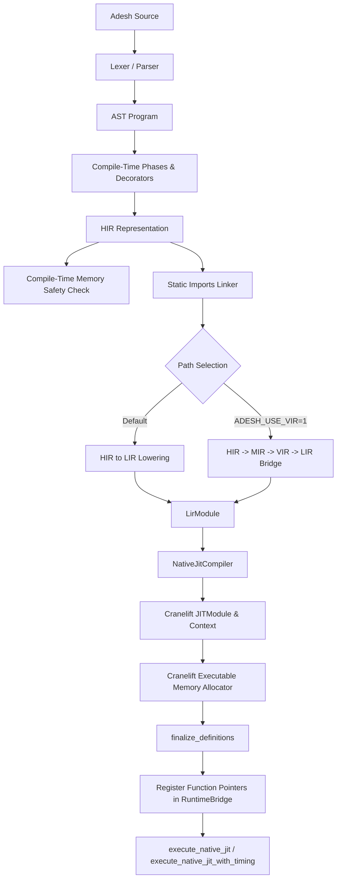
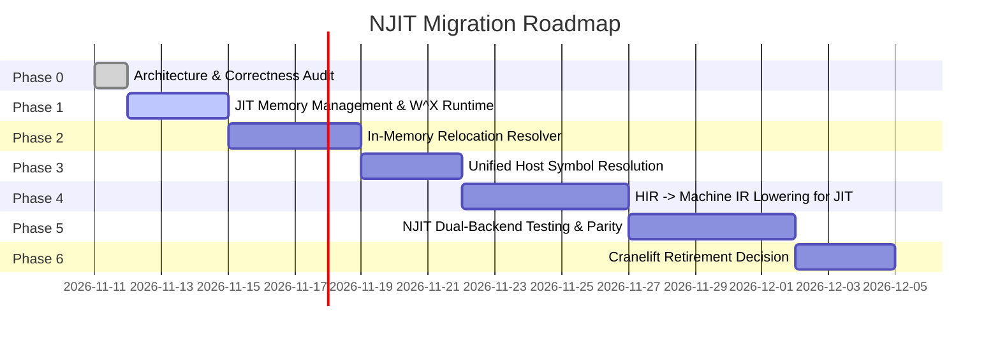

# AdeshLang Native JIT (NJIT) → Adesh Native Codegen & Linker Migration Audit

**Author:** Principal Compiler Engineer & Systems Architect  
**Status:** Audit & Investigation Complete — Ready for Review & Staged Execution  
**Target Repository:** AdeshLang (`crates/adesh-codegen`, `crates/adesh-object`, `linker`, `src/backends/jit/native`, `src/backends/native`)  
**Date:** 2026-11-11

---

### Phase 2 Deep Verification Addendum (2026-11-11)
A comprehensive secondary audit was conducted to verify every architectural claim against the real source code:
- **`docs/NJIT_NATIVE_CODEGEN_PHASE2_VALIDATION.md`**: Provides exact line-by-line verification for all 9 core assumptions, in-depth relocation pipeline tracing, $W \oplus X$ memory transitions, and handling of 64-bit branch displacements ($\pm 2\text{GB}$).
- **`docs/NJIT_NATIVE_CODEGEN_POC_SPEC.md`**: Defines a concrete vertical-slice prototype specification (`tests/njit_native_codegen_poc_test.rs`) validating native execution before wide infrastructure refactoring.
- **Key Realization on Relocations:** On x86-64, inter-function and runtime calls use `call rel32` (`RelocationKind::PcRelative32`). To guarantee that relocations never overflow when host runtime symbols are $> 2\text{GB}$ away, the JIT allocator will employ local 64-bit jump trampolines.

## 1. Executive Summary

This audit evaluates the feasibility, architectural requirements, technical debt, and staged roadmap for migrating AdeshLang's **Native JIT (NJIT)** from its current runtime backend—which relies directly on `cranelift-jit::JITModule` and `cranelift-codegen`—to AdeshLang’s own native compilation ecosystem: **`adesh-codegen` (Machine IR, register allocation, instruction encoding), `adesh-object` (ADOB object representation and relocations), and `adesh-linker` (`adeshlink`)**.

### Key Findings
1. **Divergent Lowering Pipelines:** 
   - AOT native executable generation uses `HIR -> Machine IR (adesh-codegen)` via `src/backends/native/lower.rs` (8,624 lines) or `src/backends/native/vir_lower.rs`.
   - NJIT currently routes `HIR -> LIR` (`src/backends/lir_lower.rs`) and then translates `LIR -> Cranelift IR` via `src/backends/jit/native/compiler.rs` (5,880 lines).
   - This causes massive duplication of runtime bridge calling, built-in intrinsic resolution, and type conversions.
2. **First-Class Adesh Native Codegen Parity:**
   - `adesh-codegen` already features a comprehensive x86-64 machine code encoder (`crates/adesh-codegen/src/targets/x86_64/encoder.rs`), linear scan register allocator, SysV/Win64 ABI lowerer, and relocation emitter. It passes 90 unit/integration tests (`cargo test -p adesh-codegen`).
   - AArch64 and RISC-V 64 backends are implemented in `adesh-codegen` and `adesh-linker`, whereas Cranelift NJIT is currently restricted to x86-64 due to PLT dependencies.
3. **Core Architectural Principle:**
   - **One native code generator, two execution destinations.**
   - Do **NOT** force `adeshlink` to act as an in-memory JIT executor. The linker is designed for file-based whole-program linking (PE, ELF, Mach-O, WASM).
   - Instead, create a dedicated in-memory JIT loader (`JitLoader` / `JitMemoryManager`) that consumes `adesh_codegen::machine_ir::NativeModule` or in-memory `AdobObject`, allocates executable pages via OS virtual memory APIs, applies relocations in place, and returns callable function pointers.

---

## 2. Current NJIT Architecture

### 2.1 Execution Flow


### 2.2 Entry Points & Driver
- `src/backends/jit/native/mod.rs`: Coordinates tokenization, parsing, decorator expansion, memory safety checks, static imports, HIR-to-LIR lowering, compilation via `NativeJitCompiler`, and execution via `execute_native_jit_with_timing`.
- `src/backends/jit/native/compiler.rs`: Configures `cranelift_native::builder()`, registers C runtime functions (`printf`, `malloc`, `free`, `memcpy`, `puts`), print helper functions (`print_i64`, `print_f64`, etc.), runtime bridge symbols, and ARC runtime functions (`adesh_rt_arc_new`, etc.). Translates every `LirInst` into Cranelift IR instructions.
- `src/backends/jit/native/context.rs`: Wraps `JITModule` and `HashMap<String, FuncId>`, extracting finalized function pointers via `module.get_finalized_function(func_id)`.
- `src/backends/jit/native/runtime.rs`: Looks up entry symbols (`main`, `__top_level_wrapper`, `__user_main`), casts the pointer to `extern "C" fn() -> ()`, and invokes it.
- `src/backends/jit/native/runtime_bridge.rs`: 4,302 lines of FFI bridge managing complex heap values (arrays, strings, objects, closures) through a 64-bit handle abstraction (`HANDLE_TAG = 0x4000_0000_0000_0000`).

---

## 3. Complete NJIT Dependency Map

| Component | File Path | Main Structs / Functions | Responsibility | Dependencies | Reusable in Unified Codegen? |
|---|---|---|---|---|---|
| NJIT Driver | `src/backends/jit/native/mod.rs` | `native_jit_run`, `native_jit_run_with_stats`, `NativeJitProfileStats` | Orchestrates pipeline from source to invocation | Parser, HIR, LIR, `NativeJitCompiler` | **Yes (Driver Logic)**; replace LIR/Cranelift invocation with `NativeCodeGenerator` + `JitLoader`. |
| Cranelift Compiler | `src/backends/jit/native/compiler.rs` | `NativeJitCompiler`, `compile_module`, `declare_function`, `compile_function` | Lowers LIR to Cranelift IR, allocates data & functions | `cranelift`, `cranelift_jit`, `cranelift_module`, `LirModule` | **No (Cranelift-specific)**; 5,880 lines of Cranelift lowering will be retired. |
| Execution Context | `src/backends/jit/native/context.rs` | `NativeJitContext`, `get_function`, `get_function_id` | Stores function IDs and raw function pointers | `cranelift_jit::JITModule`, `FuncId` | **Refactor into Generic `JitExecutionContext`** holding loaded memory segments and symbol map. |
| Runtime Invocation | `src/backends/jit/native/runtime.rs` | `execute_native_jit`, `execute_native_jit_with_timing` | Finds entry point (`main`, etc.), transmutes to function pointer, invokes | `NativeJitContext` | **Yes (Directly Reusable)** with generic context. |
| Runtime Bridge | `src/backends/jit/native/runtime_bridge.rs` | `get_runtime_symbols`, `store_value`, `get_value`, handle allocator | Bridges JIT-compiled code to Rust runtime data structures | `FastMap`, `RuntimeValue`, `builtins` | **Yes (Directly Reusable)**; already exposed as C-ABI symbols. |
| Print Helpers | `src/backends/jit/native/print_helpers.c` | `print_i64`, `print_f64`, `print_str`, `file_write_str` | C helpers for primitive I/O | C standard library | **Yes (Directly Reusable)**. |
| ARC Bridge | `src/execution/runtime_core/interpreter/arc_bridge.rs` | `adesh_rt_arc_new`, `adesh_rt_arc_clone`, `adesh_rt_arc_drop` | Refcounted pointer management across FFI boundary | Rust runtime alloc | **Yes (Directly Reusable)**. |

---

## 4. Audit of Adesh's Existing Native Codegen & Linker

### 4.1 Component Inventory & Maturity Classification

| Component | Repository Path | Primary Functions / Types | Classification | Evidence & Test Suite |
|---|---|---|---|---|
| **Machine IR (MIR)** | `crates/adesh-codegen/src/machine_ir/` | `NativeModule`, `MachineFunction`, `MachineBlock`, `MachineInstruction`, `MachineOperand` | **Fully implemented and tested** | Defined in `crates/adesh-codegen/src/machine_ir/mod.rs`. Used by both x86_64 and AArch64. |
| **HIR → Machine IR Lowering** | `src/backends/native/lower.rs` | `lower_hir_module`, `FunctionLoweringContext::lower_function` | **Fully implemented and tested** | 8,624 lines handling full Adesh semantics, loops, pattern matching, calls. Tested by `tests/native_phase7_conformance_corpus_test.rs`. |
| **VIR → Machine IR Lowering** | `src/backends/native/vir_lower.rs` | `vir_to_machine_ir` | **Implemented, partially tested** | Alternative lowering through VIR. |
| **x86-64 Machine Code Encoder** | `crates/adesh-codegen/src/targets/x86_64/encoder.rs` | `X86_64Encoder`, `encode_instruction` | **Fully implemented and tested** | Full REX/ModR/M/SIB, immediate, SSE2 floating point, branch fixups. Tested in `crates/adesh-codegen/src/targets/x86_64/encoder.rs`. |
| **x86-64 Backend Driver** | `crates/adesh-codegen/src/targets/x86_64/mod.rs` | `X86_64Backend`, `generate_function_with_relocations`, `emit_object` | **Fully implemented and tested** | Implements `CodegenBackend`. Emits machine code and `AdobRelocation` records. |
| **AArch64 Backend** | `crates/adesh-codegen/src/targets/aarch64/` | `AArch64Backend`, `encode_instruction` | **Implemented and tested** | Implements AAPCS64, NEON, relocations. Passes 8 tests in `targets::aarch64`. |
| **RISC-V 64 Backend** | `crates/adesh-codegen/src/targets/riscv/` | `Riscv64Backend` | **Implemented and tested** | Emits RV64 instructions, integer/FP/atomic. Passes tests in `targets::riscv`. |
| **Register Allocator** | `crates/adesh-codegen/src/register_alloc/` | `LinearScanAllocator`, `RegisterFile` | **Fully implemented and tested** | Spill weight heuristics, call splits, verification pass. Passes 20 tests. |
| **Calling Convention & ABI** | `crates/adesh-codegen/src/calling_convention/`, `src/abi/` | `WindowsX64CallingConvention`, `SystemVX64CallingConvention`, `Aapcs64CallingConvention` | **Fully implemented and tested** | Shadow space, stack arguments, struct passing, parallel move resolution. Passes 17 tests in `parallel_move_test.rs`. |
| **ADOB Object Format** | `crates/adesh-object/` | `AdobObject`, `AdobSection`, `AdobSymbol`, `AdobRelocation`, `AdobWriter`, `AdobReader` | **Fully implemented and tested** | High-performance binary format, endianness-aware, validation. 16 passing tests in `adesh-object`. |
| **adesh-linker (`adeshlink`)** | `linker/` | `Linker::link`, `LinkContext`, `ObjectReader`, `PeWriter`, `ElfWriter`, `MachOWriter`, `WasmWriter` | **Fully implemented and tested for AOT** | Multi-target linker supporting PE/COFF, ELF, Mach-O, and WASM. Passes 59 lib tests. |
| **In-Memory JIT Loader** | *None* | *Not currently implemented* | **Not implemented** | No in-memory section loader exists to map machine code into executable memory without going through Cranelift. |

---

## 5. NJIT vs Adesh Native Codegen Comparison

| Architectural Area | Existing NJIT | Adesh Native Codegen (`adesh-codegen`) | Migration Opportunity & Synergy |
|---|---|---|---|
| **Input Intermediate Representation** | LIR (`LirModule`, block-based linear IR) | Machine IR (`NativeModule`, register-based IR) | Unify frontend lowering on Machine IR. Eliminate LIR translation entirely. |
| **Instruction Selection** | Delegated to Cranelift | Direct lowering in target backend (`X86_64Encoder`, etc.) | Full control over instruction selection, immediate packing, and branch sizing. |
| **Register Allocation** | Delegated to Cranelift | In-house `LinearScanAllocator` with call-splitting | Unified register allocation across both AOT and JIT. |
| **ABI & Calling Convention** | Cranelift default ISA settings (`CallConv::SystemV` / `CallConv::WindowsFastcall`) | Explicit SysV, Win64, AAPCS64 calling conventions with parallel move resolution | Share exact ABI logic and frame layout calculations. |
| **Stack Frames** | Managed by Cranelift | Managed by `adesh-codegen` (RBP framing, red zones, spill areas) | Consistent stack traces and debugging across AOT and JIT. |
| **Relocations** | Internal Cranelift symbol resolution (`cranelift-module`) | Structured `AdobRelocation` (PCRel32, Abs64, GotRel, etc.) | Standardize on Adesh relocation descriptors for in-memory resolution. |
| **Executable Memory** | Cranelift internal page allocator (`cranelift-jit`) | *None in codegen* (Runtime has primitive `virtual_alloc`) | Implement dedicated `JitMemoryManager` with strict W^X policy. |
| **Platform Portability** | **x86-64 only** (hardcoded Cranelift PLT constraint in CI) | **x86-64, AArch64, RISC-V 64, WASM** | NJIT automatically inherits multi-arch support (Apple Silicon, ARM64 Linux, RISC-V). |
| **Runtime Bridges & Builtins** | Explicit manual symbol bindings via `builder.symbol()` | Static archive / FFI symbols resolved via symbol table | Expose single unified symbol lookup table for both JIT and Linker. |

---

## 6. How the Existing Toolchain Can Power NJIT

### Architectural Principle: One Native Codegen, Two Destinations

```mermaid
flowchart TD
    subgraph Frontend["Shared Adesh Frontend"]
        Source[Adesh Source] --> Parser[Lexer / Parser / AST]
        Parser --> HIR[HIR]
        HIR --> HIRLower[src/backends/native/lower.rs]
        HIRLower --> MachineIR[adesh_codegen::Machine IR]
    end

    subgraph NativeCodegen["Adesh Native Codegen (adesh-codegen)"]
        MachineIR --> Opt[Optimization Pipeline]
        Opt --> RegAlloc[Linear Scan Register Allocation]
        RegAlloc --> TargetBackend[Target Backend: x86-64 / AArch64]
        TargetBackend --> NativeArtifact[In-Memory Object / Machine Code + Relocations]
    end

    subgraph AOTPath["Destination A: AOT Toolchain"]
        NativeArtifact --> ADOBWriter[ADOB Object Writer]
        ADOBWriter --> DiskObject[Object File / ADOB]
        DiskObject --> AdeshLink[adesh-linker]
        AdeshLink --> FinalBinary[PE .exe / ELF Executable / Mach-O]
    end

    subgraph NJITPath["Destination B: Native JIT (NJIT)"]
        NativeArtifact --> JITLoader[adesh_jit::JitLoader]
        JITLoader --> JITMem[JitMemoryManager (W^X Allocator)]
        JITMem --> RelocResolver[In-Memory Relocation Resolver]
        RelocResolver --> SymbolTable[Runtime Symbol Resolver]
        SymbolTable --> ExecutableCode[Executable Memory]
        ExecutableCode --> Invoker[Direct Function Pointer Call]
    end
```

### Analysis of Feasibility Questions:

1. **Can the existing machine-code encoder emit code suitable for in-memory execution?**
   - **Yes.** `X86_64Encoder` emits standard x86-64 machine instructions. Functions emit branch relocations relative to the function base and symbol relocations (`RelocationKind::Pc32`, `RelocationKind::Abs64`).
2. **Can the existing relocation engine resolve relocations after code is loaded into memory?**
   - In `adesh-linker`, relocation application modifies target buffers (`apply_relocation`). While `adesh-linker` operates on section slices destined for file writing, the calculation formulas for `Pc32` (`target_addr - (site_addr + 4)`), `Abs64`, and PLT stubs are identical for memory execution.
3. **Can `adeshlink`'s symbol resolution logic be reused?**
   - Yes, specifically the symbol table structure (`SymbolTable`) and signature validation logic. However, the JIT symbol resolver must look up addresses in the **current host process** (using `GetProcAddress` / `dlsym` and internal runtime maps) rather than scanning `.a` archives on disk.
4. **Should ADOB be used as an intermediate representation for JIT?**
   - An in-memory object struct (`AdobObject` or `NativeObject`) is ideal. Serializing to disk or binary buffer and deserializing is unnecessary overhead for JIT; passing `AdobObject` or direct `(Vec<u8>, Vec<AdobRelocation>)` in memory is zero-copy and vastly faster.
5. **How should executable memory be managed?**
   - A dedicated `JitMemoryManager` must allocate pages using OS primitives:
     - Windows: `VirtualAlloc` (`MEM_COMMIT | MEM_RESERVE`, `PAGE_READWRITE`), write code, patch relocations, then `VirtualProtect` to `PAGE_EXECUTE_READ`.
     - Unix: `mmap` (`PROT_READ | PROT_WRITE`), write and relocate, then `mprotect` to `PROT_READ | PROT_EXEC`.
     - Dual-mapping (RW alias and RX alias) can be utilized on platforms enforcing strict W^X (e.g. macOS Apple Silicon `pthread_jit_write_protect_np`).
6. **Instruction Cache Flushing:**
   - On x86-64, instruction and data caches are hardware-coherent.
   - On AArch64 and RISC-V, software cache flushing is mandatory:
     - Windows ARM64: `FlushInstructionCache(GetCurrentProcess(), ptr, size)`.
     - Linux ARM64: `__builtin___clear_cache(start, end)`.
     - macOS ARM64: `sys_icache_invalidate(ptr, size)`.

---

## 7. Platform Dependency Analysis

### Current Platform Limitations in Repository:
1. **Cranelift NJIT is x86-64 only:**
   - Documented in `tests/native_phase8_jit_native_conformance_test.rs`:
     ```rust
     //! Cranelift native JIT PLT support is x86-64-only, so these tests do not
     //! run on Apple Silicon or ARM64 Linux runners.
     ```
   - This limitation comes from Adesh’s Cranelift JIT configuration and symbol resolver, which fails to synthesize PIC/PLT trampolines on non-x86_64 host ISA targets.
2. **Adesh Native Codegen is already multi-platform:**
   - `crates/adesh-codegen/src/targets/` contains active implementations for:
     - `x86_64`: Full production quality (Linux SysV, Windows Win64, macOS Mach-O).
     - `aarch64`: Full instruction encoder and AAPCS64 calling convention.
     - `riscv`: RV64GC encoder and calling convention.
3. **Operating System Portability Matrix:**

| Target Architecture / OS | Existing NJIT (Cranelift) | Adesh Native Codegen | Adesh Linker (`adeshlink`) | Target NJIT Migration Status |
|---|---|---|---|---|
| **Windows x86-64** | Supported (CI Tested) | Fully Implemented & Tested | Supported (PE/COFF Writer) | **Tier 1 (Immediate Target)** |
| **Linux x86-64** | Supported (CI Tested) | Fully Implemented & Tested | Supported (ELF Writer) | **Tier 1 (Immediate Target)** |
| **macOS ARM64 (Apple Silicon)** | **Unsupported** (Disabled in CI) | Implemented (AArch64) | Supported (Mach-O Writer) | **Tier 1 (Enables NJIT on Mac)** |
| **Linux ARM64** | **Unsupported** (Disabled in CI) | Implemented (AArch64) | Supported (ELF AArch64) | **Tier 2** |
| **Linux RISC-V 64** | **Unsupported** | Implemented (RV64) | Supported (ELF RV64) | **Tier 2** |

---

## 8. Bugs, Technical Debt, and Correctness Risks

### Confirmed Issues:

1. **Panic in Native JIT Finalization (`unwrap()` on Finalize)**
   - **Severity:** High
   - **Location:** `src/backends/jit/native/compiler.rs:214`
   - **Code:** `self.module.finalize_definitions().unwrap();`
   - **Impact:** Any symbol conflict, relocation overflow, or unmapped external function causes an unrecoverable process crash instead of returning a compiler diagnostic.
   - **Fix:** Propagate errors using `?` as `Result<NativeJitContext, String>`.

2. **W^X Policy Violation in Memory Allocation**
   - **Severity:** High
   - **Location:** `crates/adesh-runtime/src/platform/windows/mod.rs:41-45`
   - **Code:** Allocates memory with `PAGE_EXECUTE_READWRITE` directly.
   - **Impact:** Modern OS security mitigations (Arbitrary Code Guard / ACG on Windows, Hardened Runtime on macOS) block or terminate processes allocating RWX pages.
   - **Fix:** Implement stateful allocation: allocate RW, write and relocate, transition to RX via `VirtualProtect` / `mprotect`.

3. **Missing Instruction Cache Invalidation on Non-x86 Platforms**
   - **Severity:** High (Migration Blocker for ARM64)
   - **Location:** `src/backends/jit/native/runtime.rs`
   - **Impact:** Executing freshly emitted code on AArch64 without flushing the CPU instruction cache causes illegal instruction crashes (`SIGILL`) due to stale CPU pipeline caches.
   - **Fix:** Add platform-specific `clear_instruction_cache` calls in the JIT loader before executing code.

4. **Catch Unwind Masking Finalized Function Lookups**
   - **Severity:** Medium
   - **Location:** `src/backends/jit/native/context.rs:28-39`
   - **Code:** Uses `std::panic::catch_unwind` to swallow panics during `module.get_finalized_function`.
   - **Impact:** Silently hides compilation bugs and missing symbols during JIT runtime setup.

5. **LTO Promoted Runtime Probe Linker Failure**
   - **Severity:** Medium
   - **Location:** `linker/tests/lto_promoted_runtime_probe.rs:67`
   - **Code:** `probe_promoted_clone_resolution` panics due to missing symbol entry in archive index.
   - **Impact:** Lingering test failure in `adesh-linker`.

---

## 9. Proposed Unified Architecture & API Design

We introduce an independent, cohesive JIT execution module: `crates/adesh-jit` (or `adesh_codegen::jit`).

```rust
// Proposed API boundaries in adesh-codegen / adesh-jit

/// Target-independent interface for native code generation
pub trait NativeCodeGenerator {
    /// Compiles Machine IR module to an in-memory native object
    fn compile_module(
        &mut self,
        module: &NativeModule,
        opt_level: OptLevel,
    ) -> Result<AdobObject, CodegenError>;
}

/// In-memory executable code loader
pub trait JitLoader {
    /// Loads an AdobObject into executable memory, resolves relocations, and binds runtime symbols
    fn load_object(
        &mut self,
        object: &AdobObject,
        resolver: &dyn HostSymbolResolver,
    ) -> Result<JitLoadedModule, JitError>;
}

/// Host symbol resolver for JIT execution
pub trait HostSymbolResolver {
    /// Resolves external symbol by name to an absolute host address
    fn resolve_symbol(&self, name: &str) -> Option<*const u8>;
}

/// RAII wrapper managing lifetime and permissions of executable code pages
pub struct JitMemoryManager {
    allocated_pages: Vec<MemoryBlock>,
}

impl JitMemoryManager {
    /// Allocate writable memory for emitting and relocating code
    pub fn allocate_code_page(&mut self, size: usize) -> Result<*mut u8, JitError>;
    
    /// Seal pages from Writable to Executable (strict W^X enforcement)
    pub fn seal_executable(&mut self, ptr: *mut u8, size: usize) -> Result<(), JitError>;
    
    /// Invalidate instruction cache across modified range
    pub fn flush_icache(&self, ptr: *const u8, size: usize);
}
```

---

## 10. Staged Migration Roadmap



### Phase 0: Architecture and Correctness Audit (Completed)
- Full dependency mapping and comparison completed.
- Existing test suites verified: `adesh-codegen` (90/90 pass), `adesh-object` (16/16 pass), `native_phase8_jit_native_conformance_test` (10/10 pass), `native_phase7_conformance_corpus_test` (5/5 pass).

### Phase 1: In-Memory Executable Memory Manager (`JitMemoryManager`)
- **Objective:** Create a secure, cross-platform memory allocator supporting strict W^X and instruction cache invalidation.
- **Affected Files:** `crates/adesh-runtime/src/platform/`, `src/backends/jit/native/memory.rs`.
- **Complexity:** Medium.

### Phase 2: In-Memory Relocation Resolver
- **Objective:** Implement relocation application directly on in-memory buffers using `AdobRelocation` specifications.
- **Affected Files:** `crates/adesh-object/src/relocation.rs`, `src/backends/jit/native/reloc.rs`.
- **Complexity:** Medium.

### Phase 3: Unified Host Symbol Resolver
- **Objective:** Consolidate external symbols from `runtime_bridge.rs`, `print_helpers.c`, and `arc_bridge.rs` into a unified `HostSymbolResolver`.
- **Affected Files:** `src/backends/jit/native/runtime_bridge.rs`, `src/backends/jit/native/resolver.rs`.
- **Complexity:** Low.

### Phase 4: HIR → Machine IR JIT Lowering Bridge
- **Objective:** Connect the JIT driver (`src/backends/jit/native/mod.rs`) directly to `src/backends/native/lower.rs` (`lower_hir_module`), bypassing LIR and Cranelift entirely.
- **Affected Files:** `src/backends/jit/native/mod.rs`, `src/backends/native/lower.rs`.
- **Complexity:** High.

### Phase 5: Cross-Platform Validation & Conformance
- **Objective:** Run conformance tests across both Cranelift and the new Native Codegen JIT using the `--jit-backend=adesh|cranelift` flag. Verify semantic equivalence.
- **Complexity:** Medium.

### Phase 6: Cranelift Retirement Decision
- **Objective:** Benchmark execution time, compilation latency, and code size. Remove Cranelift dependencies only after demonstrating full feature parity.
- **Complexity:** Low.

---

## 11. Final Recommendation

Adopt the **"One Native Codegen, Two Execution Destinations"** model:
1. **Unify the Frontend:** Lower all executions (AOT and JIT) through `HIR -> Machine IR` via `src/backends/native/lower.rs`.
2. **Reuse `adesh-codegen`:** Use `X86_64Encoder`, `LinearScanAllocator`, and ABI lowerers for both JIT and AOT.
3. **Do NOT overload `adeshlink`:** Keep the linker focused on disk object generation. Implement a lightweight in-memory `JitLoader` to handle memory allocation and relocation patching.
4. **Retain Cranelift as an opt-in fallback** during migration via `--jit-backend=cranelift` until complete conformance is achieved on all Tier-1 platforms.
